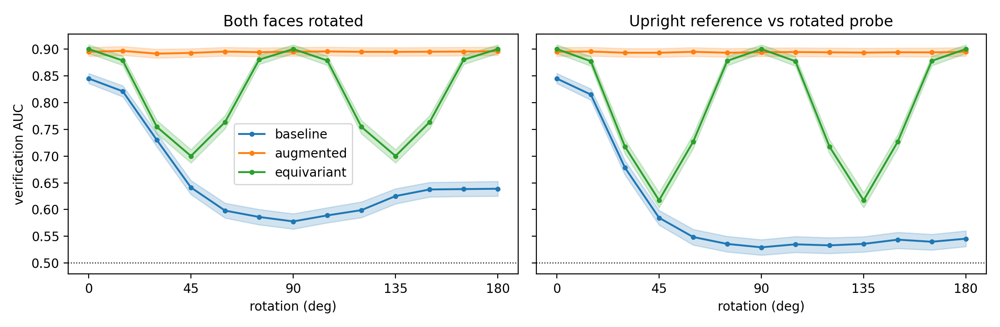
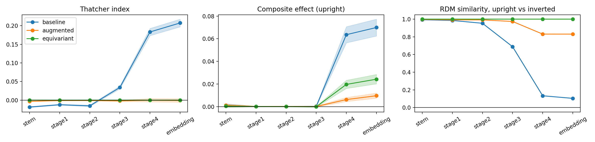

# Does orientation invariance cost holistic face processing?

Sanjana Singh & Bhavya Gajjar,
NeuroAI course project, IIT Gandhinagar. 

Face-trained CNNs, like people, are much worse at recognising upside-down faces, and they show the composite and Thatcher effects that are taken as signs of holistic processing. We made networks orientation invariant in two different ways and checked whether these effects survive.

We trained three ResNet-18 networks on the same faces:

| model | how it handles orientation | parameters |
|---|---|---|
| baseline | trained on upright faces only | 11.4M |
| augmented | trained with random 0 to 360 deg rotations | 11.4M |
| equivariant | C4 group-equivariant layers (escnn) with pooling over the 4 orientations | 7.6M |

Each model was trained twice (seeds 0 and 1).

## Data

VGGFace2, from the Hugging Face mirror `ProgramComputer/VGGFace2` (you need to accept the dataset terms there). We used the 500 training identities with at least 300 images (206,454 images) and the full test set (500 different identities, 169,396 images). Faces were aligned to 112x112 with MTCNN landmarks and the ArcFace 5-point template. A circular mask is applied to every image for every model, so the black corners left by rotation can't give away the orientation.

The images are not included here. `results/split.json` lists the identities and the validation files.

## Results

Face verification on the 500 test identities (3000 same and 3000 different pairs), mean over 2 seeds, 95% bootstrap CI in brackets.

| | baseline | augmented | equivariant |
|---|---|---|---|
| val accuracy, upright (seed 0 / 1) | 0.953 / 0.951 | 0.928 / 0.924 | 0.948 / 0.946 |
| AUC upright | 0.845 [0.837, 0.853] | 0.895 [0.887, 0.902] | 0.900 [0.893, 0.907] |
| AUC at 45 deg | 0.641 [0.630, 0.652] | 0.893 [0.885, 0.900] | 0.700 [0.689, 0.710] |
| AUC inverted | 0.639 [0.627, 0.651] | 0.896 [0.889, 0.903] | 0.900 [0.893, 0.907] |
| inversion index, (up - inv) / up | 0.244 [0.229, 0.257] | -0.001 [-0.005, 0.002] | 0 (exact, by design) |
| Thatcher index | 0.207 [0.198, 0.216] | -0.001 [-0.004, 0.003] | 0 (exact, by design) |
| composite effect | 0.070 [0.063, 0.076] | 0.010 [0.008, 0.012] | 0.024 [0.021, 0.028] |



- Only the baseline shows an inversion effect. Both invariant models recognise inverted faces as well as upright ones, and better than the baseline does upright (0.90 vs 0.85).
- The equivariant model is only invariant to 90 deg steps. At 45 and 135 deg it drops to 0.70. Since 180 deg is one of its symmetries, its inversion and Thatcher indices are exactly 0.
- The Thatcher effect is only present in the baseline, and only from stage 3 onwards.
- The composite effect is strongest in the baseline. We expected the equivariant model to lose more of it than the augmented one, but it kept more (0.024 vs 0.010).
- In the baseline, the upright and inverted representations stay similar in early layers and come apart in stages 3 and 4 (RDM correlation 0.99 at the stem, 0.10 at the embedding).

Model x orientation repeated measures ANOVA on verification AUC: interaction F(8, 152) = 494.6, p < 0.001. Pairwise model contrasts with Holm correction are in `results/analysis/model_contrasts.csv`.



## Repository

```
notebooks/01_data_and_training.ipynb   download, alignment, training (seed 0), first face tests, navon
notebooks/02_analysis.ipynb            tuning curves, layer-wise analyses, statistics, seed 1 training
results/                               all numbers behind the figures (csv)
figures/                               plots saved by the notebooks
```

Trained weights for all 6 runs are on the [releases page](https://github.com/sanjanasinghx/face-inversion-equivariant-cnn/releases/tag/v1.0). Each file has the model `state_dict`, the training history and the list of identities.

## Running it

Both notebooks were run on Google Colab with a T4 GPU and save everything to `MyDrive/face_inversion`.

1. Accept the VGGFace2 terms on Hugging Face and add your token as a Colab secret called `HF_Token`.
2. Run `01_data_and_training.ipynb`. Downloading and aligning the faces takes a few hours. Training takes about 20 min (baseline), 35 min (augmented) and 80 min (equivariant).
3. Run `02_analysis.ipynb`.

To skip training, run the setup, download and alignment parts of notebook 01, put the release checkpoints in `MyDrive/face_inversion/ckpt/` and `results/split.json` in `MyDrive/face_inversion/`, then run notebook 02 up to the second seed section. The release files have no optimizer state, so they can't be used to resume training.

The scrambled-face test shuffles tiles with a generator seeded on the CUDA device, so on other hardware the shuffles (and those numbers) come out a little different. Everything else gives the same numbers up to float16 rounding.

On Colab's Python 3.13, `lie_learn` has to be installed from GitHub before `escnn`, and `facenet-pytorch` with `--no-deps` so it doesn't replace torch. The install cells do this.

## Notes

- Verification pairs come from the VGGFace2 test set, not LFW.
- We did not compare against human similarity judgements or try a log-polar model.
- There is also a scrambled-face test and a Navon global/local test (`results/holistic_results.csv`, `results/gai_by_layer.csv`).

## References

- Dobs, Yuan, Martinez and Kanwisher (2023). Behavioral signatures of face perception emerge in deep neural networks optimized for face recognition. PNAS.
- Jacob, Pramod, Katti and Arun (2021). Qualitative similarities and differences in visual object representations between brains and deep networks. Nature Communications.
- Cohen and Welling (2016). Group equivariant convolutional networks. ICML.
- Gahl, Kulkarni, Pathak, Russell and Cottrell (2024). Visual expertise explains image inversion effects. UniReps workshop.
- Cao, Shen, Xie, Parkhi and Zisserman (2018). VGGFace2: a dataset for recognising faces across pose and age. FG.
- Yin (1969). Looking at upside-down faces. Journal of Experimental Psychology.
